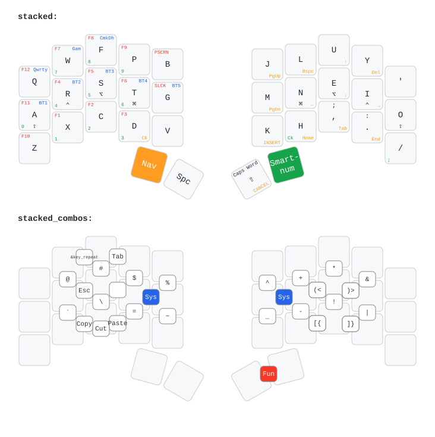

# Keymap Transformations

The `keymap transform` command restructures a keymap YAML into another keymap YAML. It is the generic replacement for `keymap stack-layers`, which remains available as a deprecated wrapper for compatibility.

`transform` output is intentionally lossy with respect to comments, formatting, and YAML anchors because the result is reserialized.

## Stacked layer recipe

This recipe combines multiple layers into a single diagram with corner legends.



```sh
keymap transform keymap.yaml \
  --include-layers Base Fun Sys Num Nav \
  --move-layer Base stacked \
  --move-layer Fun stacked:tl \
  --move-layer Sys stacked:tr \
  --move-layer Num stacked:bl \
  --move-layer Nav stacked:br \
  > stacked.yaml

keymap draw stacked.yaml > showcase_stacked.svg
```

Each key in the output can show:
- Center: primary layer tap/hold/shifted values
- Corners (`tl`/`tr`/`bl`/`br`): tap values from the moved layers

## Generic options

| Option | Description |
|--------|-------------|
| `--include-layers LAYER...` | Restrict the working set before applying moves |
| `--exclude-layers LAYER...` | Remove layers after all moves are applied |
| `--move-layer SRC[:FIELD] TARGET[:FIELD]` | Move a full layer or one legend field |
| `--move-combos SOURCE_SET TARGET` | Move combos from `*` or a comma-separated source layer list |
| `-o, --output` | Output file (default: stdout) |

Collision policy is intentionally strict:
- Operations run left to right
- Target layers can be auto-created empty
- A move can only write into an empty destination
- Reusing the same destination field is an error
- Full-layer moves can only target missing or empty layers

Error messages include the failing flag payload and the concrete destination, e.g. `Base[12].tr is already set`.

## Combo recipes

Move combos onto the stacked layer itself:

```sh
keymap transform keymap.yaml \
  --include-layers colemak_dh fun sys num nav \
  --move-layer colemak_dh stacked \
  --move-layer fun stacked:tl \
  --move-layer sys stacked:tr \
  --move-layer num stacked:bl \
  --move-layer nav stacked:br \
  --move-combos colemak_dh,nav,num stacked \
  > stacked.yaml
```

Move combos onto a separate empty layer for a second diagram:

```sh
keymap transform keymap.yaml \
  --include-layers colemak_dh fun sys num nav \
  --move-layer colemak_dh stacked \
  --move-layer fun stacked:tl \
  --move-layer sys stacked:tr \
  --move-layer num stacked:bl \
  --move-layer nav stacked:br \
  --move-combos colemak_dh,nav,num stacked_combos \
  > stacked.yaml
```

This creates:
- `stacked` for the main stacked diagram
- `stacked_combos` as an empty layer with combos overlaid on it

## Configuration

### `transform_config`

Add to your config YAML:

```yaml
transform_config:
  hidden_corner_legends:
    - ⇧
    - ⌃
    - ⌥
    - ⌘
    - sticky
    - $$mdi:pause$$
```

| Field | Type | Description |
|-------|------|-------------|
| `hidden_corner_legends` | `list[str]` | Values to hide in corner positions |
| `hidden_held_legends` | `list[str]` | Hold legend values to hide |
| `hidden_shifted_legends` | `list[str]` | Shifted legend values to hide |

`stack_config` is still accepted as a deprecated alias during the transition.

## CSS styling

Corner legends use CSS classes `tl`, `tr`, `bl`, `br` for styling. Add to `draw_config.svg_extra_style`:

```css
text.tl { fill: #F93827; font-size: 8px; text-anchor: start; dominant-baseline: hanging; }
text.tr { fill: #2563EB; font-size: 8px; text-anchor: end; dominant-baseline: hanging; }
text.bl { fill: #16A34A; font-size: 8px; text-anchor: start; dominant-baseline: auto; }
text.br { fill: #FF9D23; font-size: 8px; text-anchor: end; dominant-baseline: auto; }

use.tl { fill: #F93827; }
use.tr { fill: #2563EB; }
use.bl { fill: #16A34A; }
use.br { fill: #FF9D23; }
```

Layer activator keys can still be styled with custom `type` values such as `layer-tl` or `layer-br`, exactly as before.

## Deprecated wrapper

`keymap stack-layers` still works for one release and internally maps to:

```sh
keymap transform \
  --move-layer CENTER stacked \
  --move-layer TL stacked:tl \
  --move-layer TR stacked:tr \
  --move-layer BL stacked:bl \
  --move-layer BR stacked:br
```

See [`examples/stacked/`](examples/stacked/) for a complete working example.
